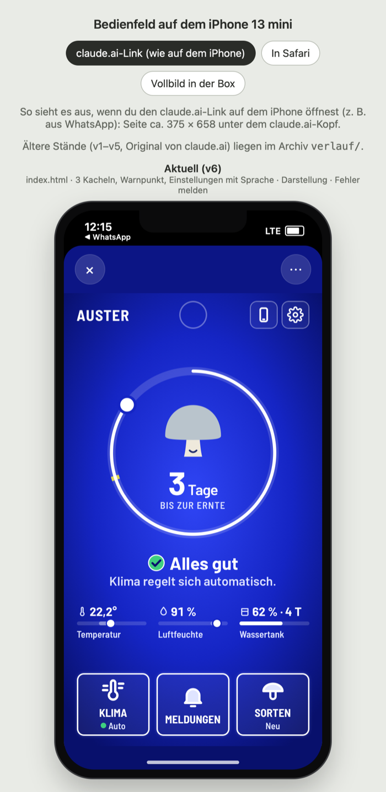
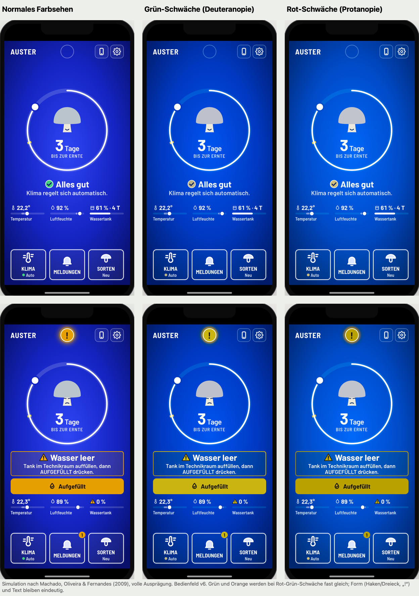

# Schritt 1 · Konzept

**Status: ✅ Stand v7 (05.11.2026)**

 

## ✅ Final

- **Zwei Personen:** A **Ingrid** (nur Box) · B **Power-User** (App als Zusatz)
- **Box regelt selbst**, der Mensch macht nur: **nachfüllen · ernten · neu ansetzen**
- **Leitidee B „Radikal einfach“:** ein Zustand · Ring bis zur Ernte · 3 Werte · **3 Kacheln KLIMA · MELDUNGEN · SORTEN**
- **Rahmen = drückbar, Trennstrich = nur Text** (Affordance, Folie 72–73)
- **Standby** nur bei „Tank leer“: schwarz, nur der orange Punkt blinkt (Folie 26–27); **kein Ruhemodus**
- **Display schlank, Erweitertes in der App**; Eigene Sorte an der Box nur nach der Ernte
- **Gleiche Wörter und Farben** in Box und App (Folie 80–81); **Orange nur für Warnungen**

## 🛤 Arbeitsweg

```
Personas ─► 3 Leitideen ─► Wahl B ─► Skizzen 01–14 ─► v1 ─► v3 Ring ─► v4 Automatik ─► v5 Folien-Review ─► v6 ─► v7
27.10.      A Begleiter                               27.10. 29.10.     29.10.          02.11.               02.11. 05.11.
            C Physisch      ✗ verworfen
```

Details je Stand: [`bedienfeld/README.md`](bedienfeld/README.md) → Verlauf

## Dateien

| Datei | Wofür |
|---|---|
| [`bedienfeld/`](bedienfeld/) | Spezifikation v7, Verlauf v1–v7 📘 |
| [`personas-storyboard.md`](personas-storyboard.md) | Personas, Storyboard „Erntezeit“ 📘 |
| [`HCI-KONZEPTE.md`](HCI-KONZEPTE.md) | Vorlesungskonzepte mit Folie |
| [`folien-recherche.md`](folien-recherche.md) | was die Folien zeigen, Kontraste, Farbsimulation 📘 |
| [`begriffe-box-app.md`](begriffe-box-app.md) | Begriffe und Schnittstelle Box ↔ App |

## Links

Skizzen 01–14: https://claude.ai/artifact/7MF2tG589SHFE4ghP35TE9 · Bedienfeld live: https://claude.ai/artifact/NHS2mr5kJKUXR1yPjPjrXi · [Begründungen E1–E31](../04-final/entscheidungen-folien.md) · [BRIEF](../BRIEF.md) · [Übersicht](../README.md) · [02](../02-box-bau/) · [03](../03-software/) · [04](../04-final/)
