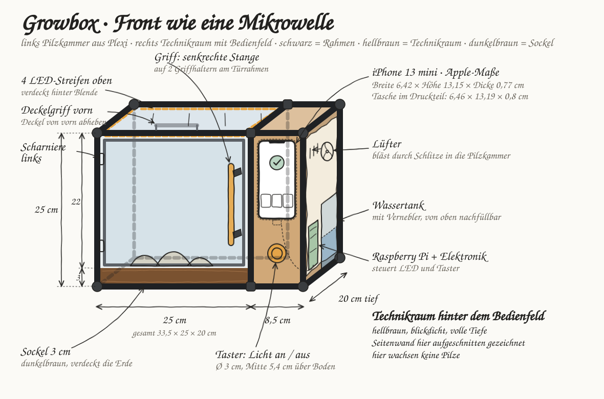
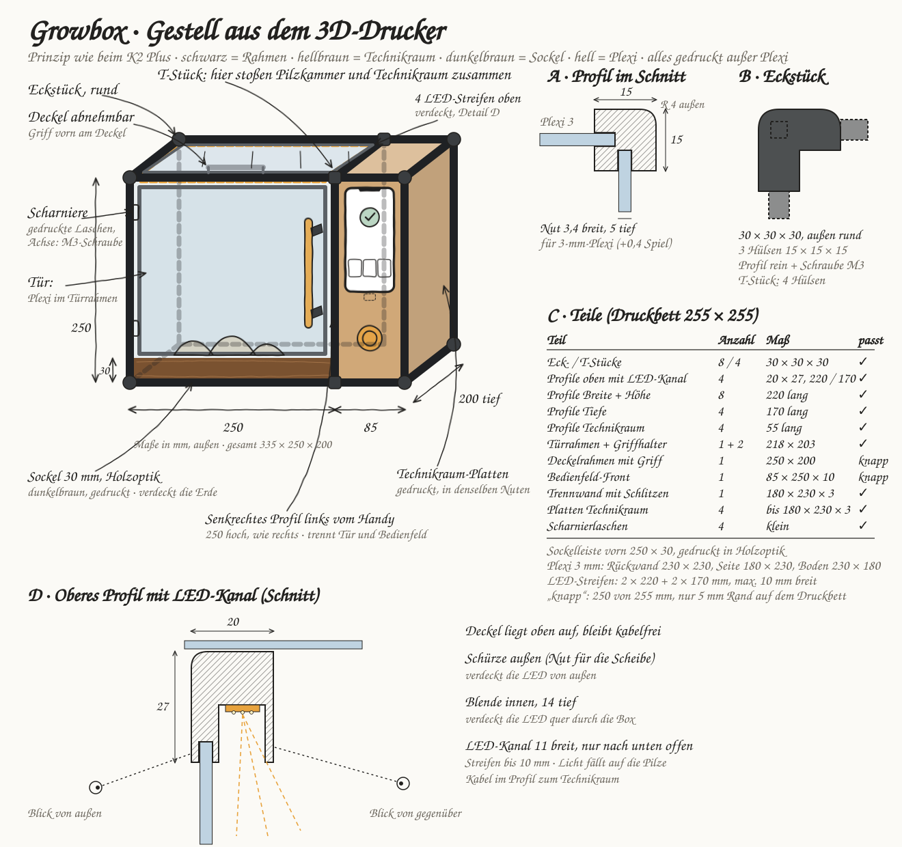
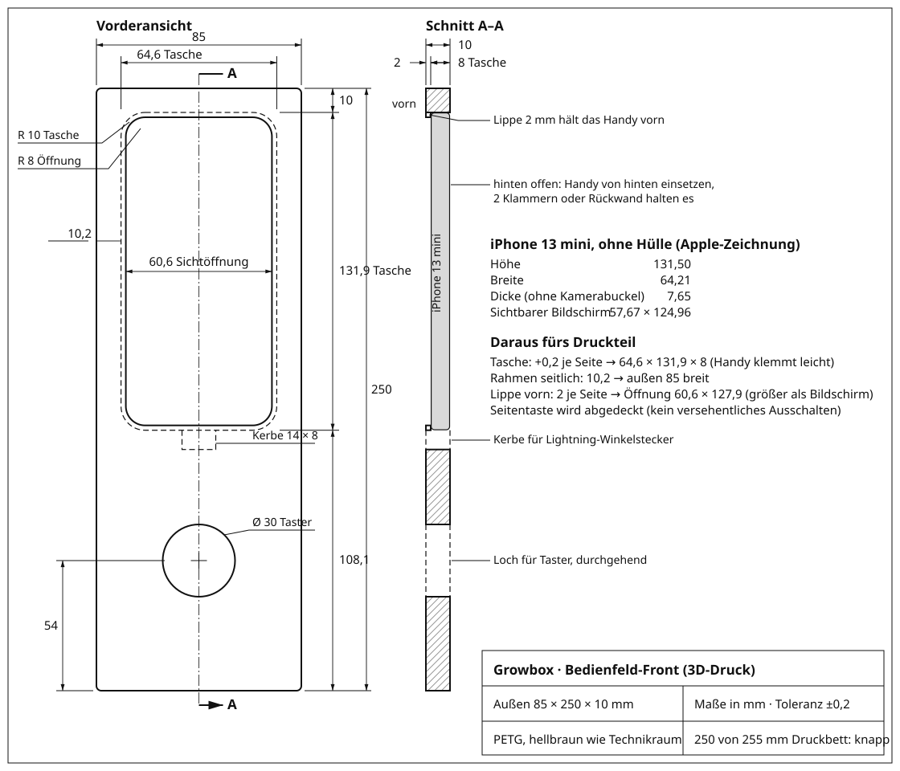

# Schritt 2 · Box-Bau

**Status: 🔄 in progress** · Gesamtübersicht: [`../README.md`](../README.md)

Zeichnungen der Box als Bilder (direkt auf GitHub sichtbar). Lokal gibt es dieselben Zeichnungen interaktiv in [`zeichnungen/index.html`](zeichnungen/index.html).

```text
02-box-bau/
├── zeichnungen/   Quellen: eine HTML-Seite je Zeichnung + index.html als Übersicht
├── bilder/        daraus erzeugte SVGs (nicht von Hand bearbeiten)
├── fonts/         Schriften für die SVGs (OFL-Lizenz)
├── export_svg.py  zeichnungen/*.html → bilder/*.svg
└── masse-iphone-13-mini.md
```

## 1 · Front-Skizze: Aufbau wie eine Mikrowelle



## 2 · Gestell aus dem 3D-Drucker (Prinzip K2 Plus)



## 3 · Sockel


## 4 · Technische Zeichnung Bedienfeld-Front



## 5 · Farbvarianten 3D-Druck

Handybox rechts fest schwarz glänzend; Rahmen, Griffe und Sockel aus beige, schwarz oder grau.


## Dateien

| Datei | Inhalt |
|---|---|
| [`zeichnungen/skizze-box.html`](zeichnungen/skizze-box.html) | Front-Skizze: Pilzkammer, Technikraum, Maße 335 × 250 × 200 |
| [`zeichnungen/skizze-gestell.html`](zeichnungen/skizze-gestell.html) | Gestell: Profile, Eckstück, LED-Profil, Teileliste |
| [`zeichnungen/skizze-sockel.html`](zeichnungen/skizze-sockel.html) | Sockel 30 mm, Bodenrahmen, Plexi-Wanne |
| [`zeichnungen/zeichnung-bedienfeld.html`](zeichnungen/zeichnung-bedienfeld.html) | Bedienfeld-Front 85 × 250 × 10 mit iPhone-Tasche |
| [`zeichnungen/skizze-farben.html`](zeichnungen/skizze-farben.html) | Drei Farbvarianten A/B/C für den 3D-Druck |
| [`masse-iphone-13-mini.md`](masse-iphone-13-mini.md) | iPhone-Maße aus Apples Zeichnung |
| [`export_svg.py`](export_svg.py) | erzeugt `bilder/*.svg` aus `zeichnungen/*.html` |

**Neue Stände als neue Datei anlegen** (z. B. `-v2`), bestehende Zeichnungen bleiben als Dokumentation. Danach `python3 02-box-bau/export_svg.py` ausführen und die Bilder mit committen. Schriften (OFL-Lizenz) liegen in `fonts/`.

## Verwandt

- Oberfläche, Personas, Vorlesungsbezug: [`../01-konzept/`](../01-konzept/)
- Entscheidungen (u. a. Maße und Material): [`../BRIEF.md`](../BRIEF.md)
