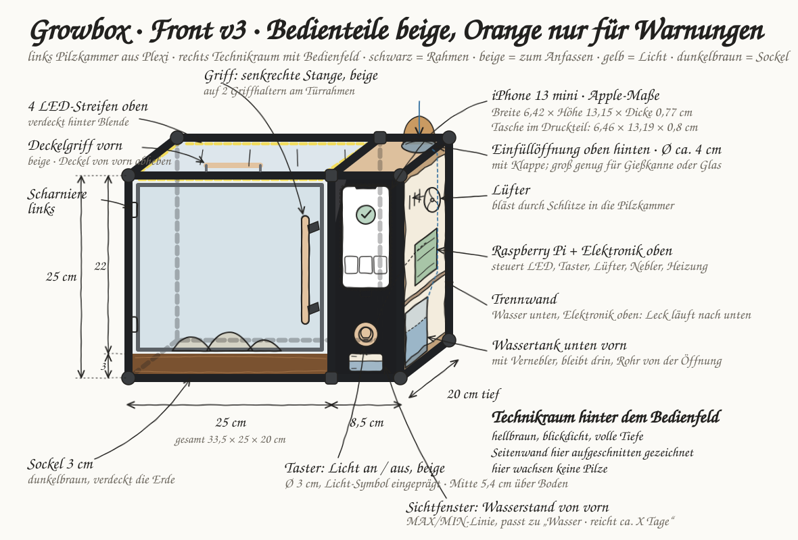
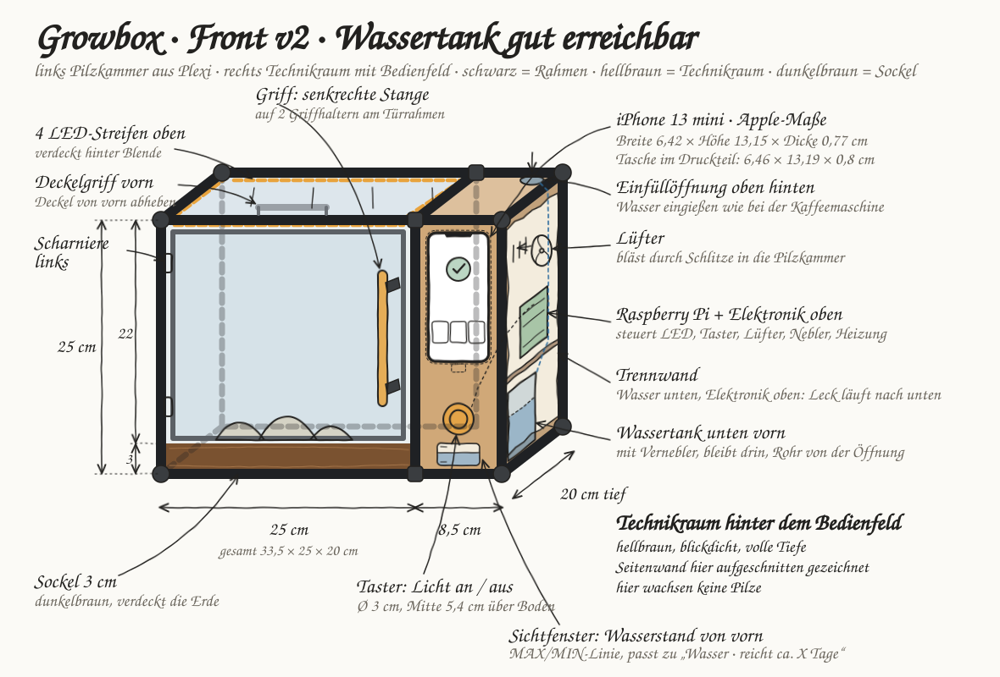
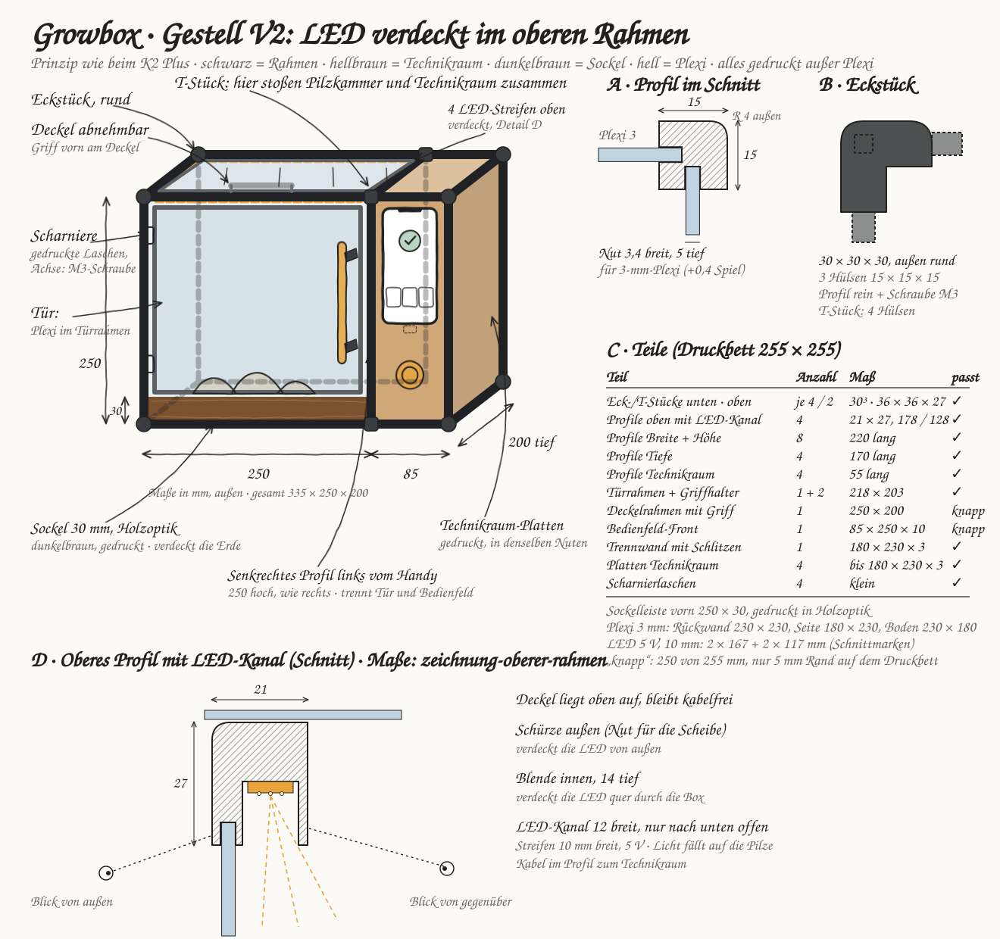
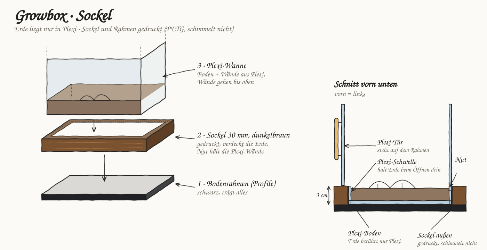
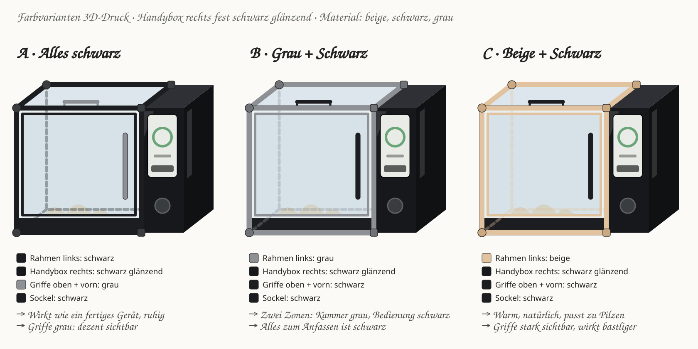

# Schritt 2 · Box-Bau

**Status: ✅** Zeichnungen V1–V3 · Prototyp im FabLab gedruckt und gebaut; CAD und Fotos im Booklet S. 07–10 und in `04-final/bilder/design-bau/`

 

## ✅ Final

- **Wie eine Mikrowelle:** links Pilzkammer (Plexi), rechts Technikraum mit Bedienfeld (Folie 8)
- **Ein Taster, eine Bedeutung:** Licht an/aus, beige mit Licht-Symbol (Affordance, Folie 72–74)
- **Tank** vorn unten mit **Sichtfenster**, Einfüllöffnung oben hinten (Mapping, Folie 77–79)
- **Beige = anfassen** (Taster, Griffe) · Rahmen schwarz/grau · **Orange nur für Warnungen** (Folie 80)
- **Gestell aus dem 3D-Drucker** (15 × 15-Profile), alle Teile ≤ 250 mm; LEDs verdeckt im oberen Rahmen
- **Kein Warnlicht** an der Box, die Warnung zeigt das Display
- 3D-Modell zum Drehen: [`../04-final/3d-modell/`](../04-final/3d-modell/)

## 🛤 Arbeitsweg 📘 Booklet S2

```
v1 Mikrowelle ──► v2 Tank gut erreichbar ──► v3 beige = anfassen ──► 3D-Modell
```

  

Bauzeichnungen:    

## Dateien

| Datei | Wofür |
|---|---|
| `zeichnungen/*.html` | Quellen, interaktiv: [`zeichnungen/index.html`](zeichnungen/index.html) |
| `bilder/*.svg` | daraus erzeugt (`python3 02-box-bau/export_svg.py`), nicht von Hand bearbeiten |
| [`masse-iphone-13-mini.md`](masse-iphone-13-mini.md) | iPhone-Maße für die Halterung |
| `fonts/` | Schriften der SVGs (OFL-Lizenz) |

Neue Stände als neue Datei (`-v2`, `-v3`), alte bleiben als Dokumentation.

## Links

[BRIEF (Maße, Material)](../BRIEF.md) · [Übersicht](../README.md) · [01](../01-konzept/) · [03](../03-software/) · [04](../04-final/)
