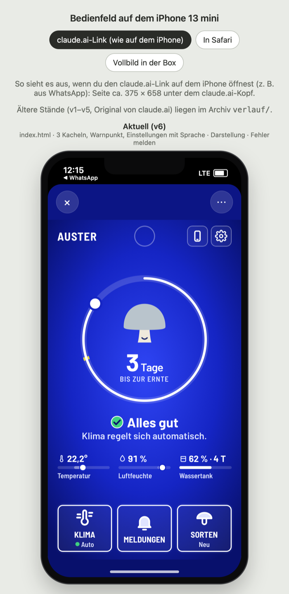
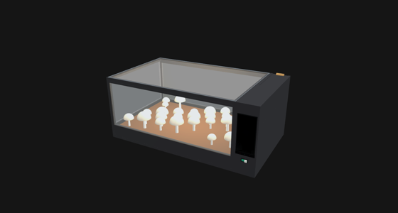

# Schritt 4 · Final

**Status: 🔄** Präsentation ✅ 05.11. · **Booklet + Prototyp bis 08.11.2026, 23:59**

 

## ✅ Final

- **Bewertet** (Folie 5): Theoriebezug · HCI-Grundprinzipien · beschriebene Technik; Booklet 50 %, Prototyp 50 %
- **Booklet:** ein gemeinsames Booklet im Grünton, [`booklet.html`](booklet.html): S. 01 Cover, S. 02 Inhalt, S. 03–07 Design & Bau (Kollege), S. 08–14 Box + Bedienfeld (Felix); Ziel 15–18 Seiten, finale Fassung am 07.11.
- **Teil Felix:** Box + Bedienfeld an Ingrid, Schwerpunkt **Fortschritt** und **Entscheidungen mit Folienbegriffen**
- **Grundlage:** Bedienfeld **v7** (`bedienfeld-v7/`), v6 als Vorher-Stand
- **Feedback Präsentation:** oranger Punkt ✓ · Fortschritt ✓ · Folienbegriffe ✓ · Rückfrage „Blau statt Schwarz?“ → Schwarz = Standby, Blau = läuft
- **Evaluation:** analytisch erledigt (Nielsen 9/10, Farbsimulation, Kontraste); Walkthrough, Nutzertest, AttrakDiff offen
- **Grenzen:** kein Warnlicht, Messwerte simuliert, Personas sind Annahmen

## 🛤 Arbeitsweg

```
02.11. Plan + v6 eingefroren ──► 04.11. Spickzettel, Admin 2 Fälle ──► 05.11. Präsentation ✅ ──► 08.11. Booklet
                                                                       v7 eingefroren, 3D-Modell
```

Booklet-Stand 07.11.: 14 Seiten inkl. Inhaltsverzeichnis ✅ · Plan für 17 Seiten in [`booklet-plan.md`](booklet-plan.md)

## Dateien

| Datei | Wofür |
|---|---|
| [`booklet.html`](booklet.html) | **das Booklet** (Doppelseiten, „Übersicht“ in drei Spalten, PDF/Drucken) |
| [`booklet-plan.md`](booklet-plan.md) | Plan für das Treffen am 07.11.: Abgleich, Konzeptweg V1–V3, 17 Seiten |
| [`booklet-felix.md`](booklet-felix.md) | Arbeitsstand zu Felix' Seiten: umgesetzt, neu, offen |
| [`booklet-design-bau/`](booklet-design-bau/) | Original „Design & Bau“ des Kollegen (6 Seiten + Bilder) |
| [`entscheidungen-folien.md`](entscheidungen-folien.md) | E1–E31 mit Folie, Story, Nielsen-Check, Grenzen 📘 |
| [`praesentation.md`](praesentation.md) | ✅ gehalten: Ablauf, Spickzettel, Rückfragen 📘 |
| [`bedienfeld-v7/`](bedienfeld-v7/) · [`bedienfeld-v6/`](bedienfeld-v6/) | eingefrorene Stände; öffnen: `vorschau-iphone.html` |
| [`3d-modell/`](3d-modell/) | 3D-Modell zum Drehen: `growbox-3d-v2-60x35x25.html` (Glasfront), `growbox-3d-mit-tuer.html` (Vorgänger) |
| [`bilder/`](bilder/) | Farbsimulation (Beleg Folie 23) 📘, Bild des 3D-Modells, Booklet-Bilder (`booklet/`, `design-bau/`) |
| [`evaluation/`](evaluation/) | Ablage für Tests |

## Links

[Learnings](../learnings.md) · [Folienbelege](../01-konzept/folien-recherche.md) · [BRIEF](../BRIEF.md) · Bedienfeld live: https://claude.ai/artifact/NHS2mr5kJKUXR1yPjPjrXi · [Übersicht](../README.md) · [01](../01-konzept/) · [02](../02-box-bau/) · [03](../03-software/)
