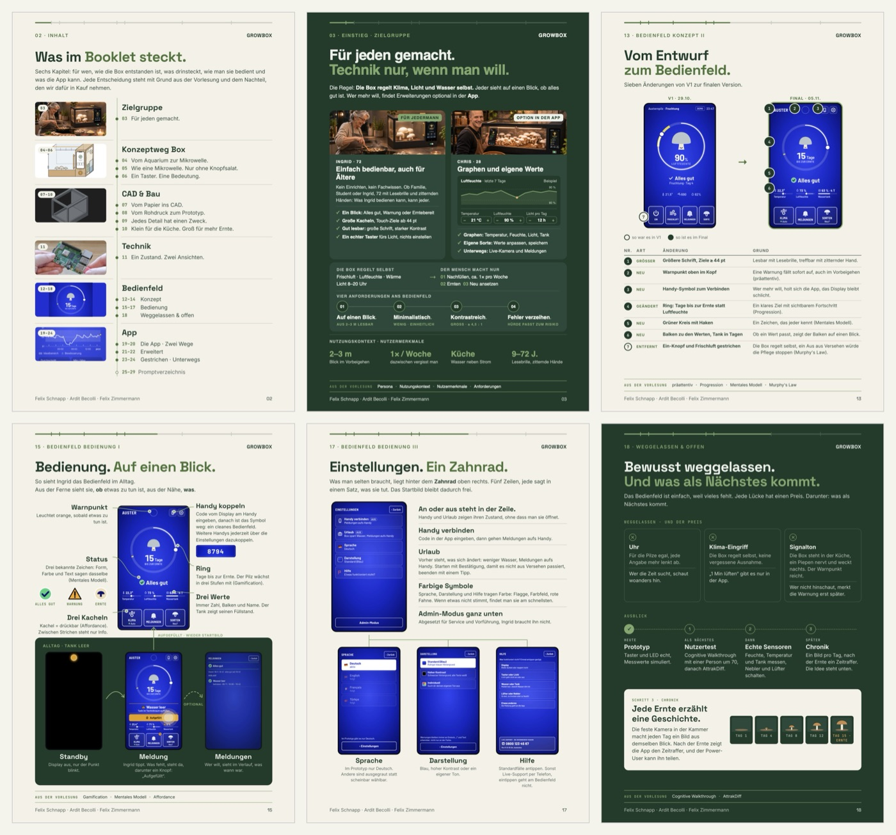

# Baukasten: Booklet und Präsentation

Wiederverwendbare Gestaltung aus dem HCI-Booklet „M-M Interaction“ (29 Seiten, abgegeben 08.11.2026). **Für Agenten in künftigen Uni-Projekten:** Diese Datei vor dem ersten Seitenbau lesen. Sie legt Anordnung, Schriftgrößen, Kopf- und Fußzeilen, den Bezug auf die Vorlesungsfolien und die Grafik-Muster fest. Felix' persönliche Learnings aus den Präsentationen stehen in `learnings.md` und in seinem Obsidian-Thema „Mensch-Maschine-Interaktion“.



**Vorlagen zum Kopieren:** `04-final/booklet.html` (ganzes Booklet, eine Datei) · `04-final/vorlage-seite.html` (alle Maße und Regeln auf einer Seite) · `04-final/booklet-pdf.py` (PDF-Export) · Ergebnis: `04-final/Zimmermann_Felix_WS2627_Booklet.pdf`. Seitenverweise unten („S. 13“) beziehen sich auf diese PDF; im HTML heißt die Seite `section.p13`. **Kopfzeile mit Fortschrittsbalken und Inhaltsverzeichnis als fertiger, getesteter Code: Abschnitt 10.**

## 1 · Ablauf: erst festlegen, dann bauen

```
Tag 1 mit dem Team ─► Format + Maß-Vorlage + Farben + Kopf/Fuß ─► Kapitelplan mit Seitenbereichen
   ─► je Seite ein Grafik-Muster wählen (Abschnitt 5) ─► Seiten bauen, Begriffe aus den Folien prüfen
   ─► Final-Check (1 Tag vor Abgabe) ─► PDF + Übersichtsbild
```

1. **Format und Maß-Vorlage zuerst, gemeinsam mit allen, die Seiten liefern.** Bei uns entstand die Vorlage erst am Abend vor dem letzten Tag; danach mussten alle Seiten angeglichen werden (119 von 256 Commits an den letzten zwei Tagen).
2. **Widersprüche zwischen den Teilen sofort entscheiden** (bei uns Taster ↔ Schiebeschalter, Tank mit Öffnung ↔ Schieber). Offene Widersprüche stehen sonst bei der Abgabe noch im Booklet.
3. **Begründungen laufend mit Folie notieren** (Tabelle E1, E2 … mit Entscheidung · Folie · Persona, bei uns `04-final/entscheidungen-folien.md`). Das Booklet greift darauf zurück.
4. **Promptverzeichnis laufend mitschreiben:** pro wichtigem Prompt eine Zeile „Schritt · Prompt (sinngemäß)“, statt es am Ende aus Git zusammenzusuchen.
5. **Final-Check einen Tag vor der Abgabe** (Abschnitt 8): Widersprüche, gleiche Wörter für dasselbe, fehlende Zahlen, Fachbegriffe gegen die Folien. Dann bleibt Zeit, Teammitglieder zu ihren Seiten zu fragen.

## 2 · Seitenaufbau (grafische Anordnung)

A4 = 794 × 1123 px, Ränder seitlich 64 px. Fest sind nur diese Abstände; dazwischen ist das Layout frei.

```
 28 px  ── Fortschrittsbalken (3 px, Kapitelgrenzen als Striche)
 56 px  04 · KONZEPTWEG BOX I                                GROWBOX     ← Kopf
  ↕ 28 px
        Titel als Aussage.
        Zweite Zeile in Akzentfarbe.                                      ← Titel 40 px
  ↕ 8 px
        Einleitung, 2–3 Zeilen, Schlüsselwörter fett                     ← max. 666 px breit
        ┌──────────────────────────────────────────────────────┐
        │ Inhalt: EIN Hauptmuster aus Abschnitt 5 (+ höchstens  │
        │ ein Nebenmuster), Layout je Seite frei                │
        └──────────────────────────────────────────────────────┘
  ↕ frei
        ── AUS DER VORLESUNG  Begriff · Begriff · Begriff ──             ← nur wenn Begriffe im Text
  ↕ 12 px
        Namen                                                    04      ← Fuß
 28 px bis zum Seitenrand
```

- **Gemeinsame Maße, kein Einheitsdesign:** Kopf, Titel, Schriftgrößen, Textfarben und Fuß sind auf allen Seiten gleich; Anordnung, Bilder und Grafiken unterscheiden sich bewusst (Abschnitt 6).
- **Jedes Thema nur einmal:** Was eine Seite erklärt, wird auf anderen nur genannt, Verweis über den Seitentitel („siehe ‚Ein Taster. Eine Bedeutung.‘“).
- **Cover ohne Kopf, Fuß und Seitenzahl;** Promptverzeichnis als Anhang in kleinerer Schrift (`section.page.tight`).

## 3 · Schrift: jede Textart genau eine Größe

Vor dem ersten Seitenbau festlegen und danach nicht mehr verhandeln. Passt etwas nicht, **Text kürzen statt Schrift verkleinern**. Werte lassen sich im Headless-Browser per `getComputedStyle` nachmessen. Umrechnung für Druck/Word/Figma: pt = px × 0,75.

| Textart | Schrift | px | ≈ pt | Hinweis |
|---|---|---|---|---|
| Titel | Space Grotesk 700, Zeilenhöhe 1.02, −0.02em | 40 | 30 | 2. Zeile Akzentfarbe, Punkt am Ende, linksbündig |
| Einleitung | Inter 400, Zeilenhöhe 1.55 | 15 | 11 | 2–3 Zeilen, max. 666 px breit |
| Fließtext, Tabelle, Legende | Inter 400, Zeilenhöhe 1.45 | 12,5 | 9,4 | Tabellenkopf siehe Label |
| Karten-, Bild-, Legendentitel | Space Grotesk 700, Zeilenhöhe 1.2 | 19 | 14 | |
| Klein, Bildunterschrift | Inter 400, Zeilenhöhe 1.4 | 11,5 | 8,6 | gedämpfte Farbe |
| Label (über Bildern, Karten, Tabellen) | Inter 700, Versalien, 0.1em | 11 | 8,3 | Aufzählung mit „ · “ |
| Unterzeile im Zeitstrahl | Inter 700, Versalien, 0.08em | 9,5 | 7,1 | Akzentfarbe, nur dort |
| Kopf | Inter 600, Versalien, 0.14em | 13 | 9,8 | Akzentfarbe; rechts Marke Space Grotesk 700 14 px |
| Leiste: Begriffe / Label | Inter 400 11,5 / JetBrains Mono 700 9,6, 0.14em | | | Label in Akzentfarbe |
| Fuß | Inter 400, Seitenzahl Space Grotesk | 13 | 9,8 | gedämpft |

**Drei Textfarbstufen** (plus Akzent), getrennt für dunkle und helle Seiten. `-webkit-font-smoothing: auto` lassen, mit `antialiased` wirkt Weiß grauer.

| Stufe | Dunkle Seite (Waldgrün `#1D3B2A`) | Helle Seite (Creme `#F3F1E7`) | Wofür |
|---|---|---|---|
| Hell | `#EEF2EA` | `#1D3B2A` | Titel, Fettes, Kartentitel, erste Tabellenspalte |
| Mittel | `#D5DED6` | `#2F4A3A` | Einleitung, Fließtext, Tabellen |
| Gedämpft | `#B4C2B6` | `#5D6A60` | Bildunterschriften, Kleines, Fuß |
| Akzent | `#7FA86C` (Salbei) | `#4A7339` | Kopf, 2. Titelzeile, Labels, Linien |

Karten: auf Grün `#27493A`, auf Creme `#FBFAF5`. Signalfarbe (bei uns Orange) nur für **eine** Bedeutung.

## 4 · Kopf- und Fußzeile, Orientierung

- **Kopf:** links „Seitenzahl · KAPITEL“ mit **römischer Zahl** für Unterseiten eines Kapitels (`04 · KONZEPTWEG BOX I`, `II`, `III`), rechts die Marke.
- **Fortschrittsbalken** (`.kbar`, per Script vor jede Seite gesetzt): Breite = Seite / Seitenzahl, **Striche an den Kapitelgrenzen** (Array `GRENZEN` im Script), vergangene Abschnitte in Akzentfarbe. So weiß der Leser, wo er ist, ohne Seitenzahlen im Text.
- **Fuß:** links die Namen der Autoren der Seite, rechts die Seitenzahl. Fremde Kapitel tragen nur ihre Autoren (bei uns die App-Seiten nur „Adelin Dinicu“).
- **Inhaltsverzeichnis** nur mit Seitentiteln, ohne Untertitel (Muster „Kapitel-Strahl“, Abschnitt 6; Code in Abschnitt 10).

Code für Kopfzeile, Fortschrittsbalken, Leiste und Fuß: **Abschnitt 10**.

## 5 · Bezug auf die Vorlesungsfolien

```
Aussage im Satz ─► „(Begriff)“ direkt dahinter ─► Leiste unten wiederholt genau diese Begriffe
      │                     │
      │                     └─ nur wenn der Begriff wörtlich auf den Folien steht (vorher prüfen)
      └─ der Satz erklärt den Begriff: „Seine Form zeigt: drücken (Affordance).“
```

- **Begriff in Klammern direkt hinter der Aussage**, nicht als Fußnote. Die Leiste „Aus der Vorlesung“ unten wiederholt **genau diese** Begriffe in **derselben Reihenfolge**, höchstens **eine Zeile**. Keine Begriffe im Text → keine Leiste. Passt sie nicht in eine Zeile, einen Begriff aus Text und Leiste streichen.
- **Keine Folien- und Seitennummern.** Der Professor konnte mit Nummern wenig anfangen; Fachbegriffe wurden in der Präsentation gelobt.
- **Nur Begriffe von den Folien:** Folientext extrahieren (Abschnitt 8) und jeden Begriff suchen. Die Folien nutzen teils deutsche Namen, z. B. „Detailgenauigkeit“ und „Auflösung“ statt „Fidelity“.
- **Fachbegriffe auch als Gliederung nutzen:** z. B. Hassenzahl „Warum · Was · Wie“ für drei Konzeptseiten, Persona, Nutzungskontext, Nutzermerkmale als Labels.
- **Keine dekorativen Zuordnungen:** Nur wenn der Begriff die Entscheidung wirklich begründet. Lieber zwei treffende Begriffe als fünf generische.

## 6 · Grafische Darstellungen (Katalog)

Pro Seite **ein Hauptmuster**; zwei aufeinanderfolgende Seiten nie mit demselben Muster.

| Muster | Wofür | Seite | So gebaut |
|---|---|---|---|
| **Nummern-Zeitstrahl 01–04** | Anforderungen, Schritte, Regelkreis | S. 03, 11, 18 | 4er-Raster, Kreise 32 px mit 1,5-px-Akzentrand, Verbindungslinie 1 px auf Kreismitte; darunter Titel 15 px + Akzentpunkt, Unterzeile 9,5 px Versalien mit „ · “ (Bauteil unten) |
| **Kapitel-Strahl** (Inhalt) | Inhaltsverzeichnis | S. 02 | je Kapitel Vorschaubild mit Seiten-Chip links, rechts Kapitelname + Seitentitel; **ein** durchgehender senkrechter Strahl, ein Punkt je Seite; Trennstriche mit Abstand zur Linie; **Code: Abschnitt 10** |
| **Konzeptweg-Zeitleiste** | Entwicklung V1 → V3 | S. 04 | Punkte mit Datum über den Bildern, V1 klein, spätere Stände groß, darunter Abwägungstabelle |
| **Annotierte Skizze** | Aufbau eines Objekts | S. 05 | große Skizze mit Nummern 1–6 im Bild, Legende daneben in Zahlenreihenfolge |
| **Entscheidungstabelle** | jede Abwägung | S. 04, 06, 21 | Spalten **Entscheidung · Grund (Begriff) · Nachteil**; der ehrliche Nachteil zeigt, dass abgewogen wurde. Variante S. 12: „Was blieb · warum“ |
| **Drei Ideen, eine gewählt** | Varianten | S. 12 | drei Skizzen nebeneinander mit Label „verworfen / gewählt“, gewählte rechts |
| **Vorher/Nachher mit Nummern** | Iteration | S. 13 | V1 und Final nebeneinander, Nummernkreise im Bild (leer = vorher, gefüllt = jetzt), darunter Tabelle Nr. · Art · Änderung · Grund |
| **Zustände nebeneinander** | Farb-/Modusvarianten | S. 14 | drei gleich große Screens mit Label und Zweizeiler |
| **Annotierter Screen + Ablauf-Band** | Bedienung im Alltag | S. 15 | Screen mittig, Erklärungen links/rechts mit geschwungenen Linien; darunter farbiges Band mit dem Use Case als Bildfolge (Standby → Meldung → zurück), optionaler Schritt gestrichelt |
| **Zwei Wege als Bildreihen** | Alternativen im Ablauf | S. 16 | zwei Reihen Screens mit Pfeilen, je Reihe Label „WEG 1 · …“; Sonderfall farbig abgesetzt |
| **Baum mit rechten Winkeln** | Menü → Unterseiten | S. 17 | oben Liste + Erklärzeilen, darunter drei Unterseiten an rechtwinkligen Linien |
| **Eingang → Kern → Ausgang** | Technik, Datenfluss | S. 11 | drei Spalten, Kern als dunkle Fläche, Pfeile dazwischen |
| **Persona-Kartenpaar + Kennzahlen** | Zielgruppe | S. 03 | zwei Karten mit Foto und ✓-Liste, darunter Kennzahlenzeile (2–3 m · 1× / Woche · Küche · 9–72 J.) |
| **Weggelassen & offen** | Grenzen, Ausblick | S. 18 | **drei Darstellungsformen auf einer Seite:** ✕-Karten „Was · Warum · Preis“ → Ausblick-Zeitstrahl ✓ Heute · 1 · 2 · 3 → helle Karte mit Bildleiste (Chronik Tag 1 → 15) |
| **Gestrichen-Tabelle** | Iterationsbeleg | S. 23 | Runden-Zeitstrahl, darunter „Gestrichen · Warum gebaut · Warum raus · Vorlesung“ |

**Bauteil Nummern-Zeitstrahl** (aus S. 03, Farben für dunkle Seite):

```html
<div style="display:grid;grid-template-columns:repeat(4,minmax(0,1fr));gap:14px">
  <div style="position:relative;display:flex;flex-direction:column;gap:5px">
    <div style="position:absolute;top:16px;left:34px;right:-14px;height:1px;background:#5E7F6C"></div>
    <div style="position:relative;width:32px;height:32px;border:1.5px solid #7FA86C;border-radius:50%;background:#1D3B2A;
                display:flex;align-items:center;justify-content:center;font:600 11.5px 'Space Grotesk';color:#EEF2EA">01</div>
    <div style="font:700 15px/1.15 'Space Grotesk';color:#EEF2EA">Auf einen Blick<span style="color:#7FA86C">.</span></div>
    <div style="font:700 9.5px/1.4 Inter;letter-spacing:.08em;text-transform:uppercase;color:#7FA86C">Aus 2–3 m lesbar</div>
  </div>
  <!-- 02 … 04 gleich; beim letzten Element die Verbindungslinie weglassen -->
</div>
```

## 7 · Abwechslung

- **Eigenes Bildmuster je Seite** aus Abschnitt 6, vor dem Bauen im Seitenplan zuordnen. Gleiche Maße halten das Booklet zusammen, verschiedene Muster halten es lebendig.
- **Hintergründe wechseln** zwischen dunkel (Waldgrün) und hell (Creme), ungefähr im Wechsel; auf beiden gelten dieselben Leisten- und Schriftregeln.
- **Innerhalb einer Seite** dürfen zwei bis drei Formen zusammenkommen, wenn sie eine Reihenfolge erzählen (S. 18: Karten → Zeitstrahl → Bildleiste).
- **Nicht jede Seite braucht eine Tabelle oder eine Leiste.** Bedienungsseiten (S. 15–17) zeigen echte Use Cases mit Bildern statt Tabellen.

## 8 · Technik und Prüfen

- **Eine HTML-Datei:** jede Seite `<section class="page">` in A4, `@page{size:A4;margin:0}`; Ansichten Doppelseiten (Pfeiltasten), `?uebersicht` (Raster, Klick zoomt), `?alle`. Seiten anderer als `iframe` einbetten, Bilder selbst enthalten.
- **PDF:** `python3 04-final/booklet-pdf.py`: Headless-Brave druckt, danach setzt das Skript die Zwei-Seiten-Ansicht mit Cover links (`/PageLayout /TwoPageLeft`). Nur Standardbibliothek.
- **Übersichtsbild:** Headless-Brave `--screenshot --window-size=1800,2200 "booklet.html?uebersicht"`.
- **Screens aus dem Klick-Prototyp:** per Headless-Brave, gleiche Größe (bei uns 600 × 1050), **feste Uhrzeit**, damit alle Bilder gleich aussehen.
- **Text aus PDF ziehen** (Final-Check und Begriffsprüfung gegen die Folien), macOS ohne Zusatzpakete:

```swift
import PDFKit   // swift text.swift datei.pdf > text.txt
for a in CommandLine.arguments.dropFirst() { print(PDFDocument(url: URL(fileURLWithPath: a))?.string ?? "") }
```

Final-Check im Text suchen nach: Widersprüchen zwischen Seiten, verschiedenen Wörtern für dasselbe (bei uns „Wasser leer“ · „Tank leer“ · „Wasser fehlt“), fehlenden Zahlen (`in,5`, `alle,,`), Seitenverweisen, Begriffen in Leisten, die nicht im Text stehen.

## 9 · Präsentation

- **Spickzettel mit Zeitmarken:** Zeitstrahl oben, je Abschnitt *Tipp-Anweisung kursiv* + Sprechtext, Probelauf-Tabelle „Bin ich hier spätestens?“, „Zu lang? Zuerst X weglassen“ (Muster: `04-final/praesentation.md`).
- **Rückfragen-Tabelle:** Frage → Ein-Satz-Antwort für jede auffällige Gestaltungsentscheidung.
- **Vorführmodus:** versteckter Admin-Modus mit zwei festen Fällen und „Zurücksetzen“.
- Aufbau und Feedback (Rahmen zuerst, Problem am Ende): `learnings.md`.

## 10 · Bausteine zum Kopieren: Kopfzeile und Inhaltsverzeichnis

Bereinigt aus `04-final/booklet.html` (dort über mehrere Iterationen gewachsen, ältere Regeln überschrieben) und als eigenständige Seite getestet: sieht aus wie S. 02 und S. 04 des Booklets. Für ein neues Projekt CSS, HTML und Script in eine leere HTML-Datei kopieren, dann Farben in `:root` und Inhalte tauschen.

```
 ━━━━━━━━━━━━━━━┿━━━━┿─────────────┿──────────┿────   ← Fortschrittsbalken (.kbar): Seite / Seitenzahl, Striche = Kapitelgrenzen
 02 · INHALT                                    GROWBOX   ← Kapitelkopf (.top), Unterseiten mit römischer Zahl
 Was im Booklet steckt.
 ┌──────────┐ │  Zielgruppe
 │ Bild  03 │ ●  03  Für jeden gemacht.                    ← Inhaltsverzeichnis (.toc): Bild + Seiten-Chip links,
 └──────────┘ │                                              ein senkrechter Strahl durch alle Seitenpunkte
 ──────────── │ ────────────────────────────────            ← Trennlinie mit Lücke um den Strahl
 ┌──────────┐ │  Konzeptweg Box
 │ Bild 04–06│ ●  04  Vom Aquarium zur Mikrowelle.
 └──────────┘ ●  05  …
              ○  25–29  Promptverzeichnis                   ← Anhang: hohler Punkt, gedämpft
```

**Schriften** (im `<head>`):

```html
<link href="https://fonts.googleapis.com/css2?family=Inter:wght@400;600;700&family=Space+Grotesk:wght@600;700&family=JetBrains+Mono:wght@700&display=swap" rel="stylesheet">
```

**CSS:**

```css
/* ── Farben: helle Seite (Creme) als Standard, .dark = Waldgrün ── */
:root{--cream:#f3f1e7;--green:#1d3b2a;--green-line:#3d5e4c;--sage:#7fa86c;--sage-text:#4a7339;
  --ink:#1d3b2a;--text:#2f4a3a;--muted:#5d6a60;--line:#c8ccbe;--accent:var(--sage-text)}
/* ── Seite A4: Kopf 56 px von oben, Ränder 64 px, Fuß 28 px über dem Rand ── */
.page{position:relative;box-sizing:border-box;width:794px;height:1123px;padding:56px 64px 28px;margin:0 auto 20px;
  display:flex;flex-direction:column;gap:16px;overflow:hidden;break-after:page;
  background:var(--cream);color:var(--ink);font:400 12.5px/1.45 Inter,sans-serif}
.page.dark{background:var(--green);--ink:#eef2ea;--text:#d5ded6;--muted:#b4c2b6;--line:var(--green-line);--accent:var(--sage)}
@page{size:A4;margin:0}
@media print{body{background:none}.page{margin:0}}
/* ── Kopfzeile: Fortschrittsbalken (per Script) + Kapitelkopf ── */
.kbar{position:absolute;top:28px;left:64px;right:64px;height:3px;border-radius:2px;background:var(--line)}
.kbar>i{position:absolute;left:0;top:0;bottom:0;border-radius:2px;background:var(--accent)}
.kbar b{position:absolute;top:-4px;width:2px;height:11px;margin-left:-1px;border-radius:1px;background:var(--line)}
.kbar b.on{background:var(--accent)}
.top{display:flex;justify-content:space-between;align-items:center;font:600 13px Inter,sans-serif;letter-spacing:.14em;text-transform:uppercase;color:var(--accent)}
.top .brand{font:700 14px "Space Grotesk",sans-serif;letter-spacing:.04em;color:var(--ink)}
/* ── Titel (Kopf → 28 px → Titel → 8 px → Einleitung) ── */
h1{font:700 40px/1.02 "Space Grotesk",sans-serif;letter-spacing:-.02em;margin:12px 0 0}
h1 em{font-style:normal;color:var(--accent)}
.lead{max-width:666px;margin:-8px 0 0;font-size:15px;line-height:1.55;color:var(--text)}
.lead b{color:var(--ink)}
/* ── Inhaltsverzeichnis: Kapitel mit Bild, ein senkrechter Strahl durch alle Seitenpunkte ── */
.toc{position:relative}
.toc:before{content:"";position:absolute;left:229.5px;top:0;bottom:0;border-left:1.5px solid var(--sage)}
.toc .tr{position:relative;display:grid;grid-template-columns:200px 1fr;gap:0 26px;padding:11px 0}
.toc .tr+.tr:before{content:"";position:absolute;top:0;left:0;right:0;height:1px;
  background:linear-gradient(90deg,var(--line) 0 220px,transparent 220px 242px,var(--line) 242px)}
.toc .im{position:relative;height:96px;border-radius:8px;overflow:hidden;background:var(--green)}
.toc .im>img{width:100%;height:100%;object-fit:cover;display:block}
.toc .n{position:absolute;left:8px;top:8px;background:var(--cream);color:var(--green);font:700 10px "JetBrains Mono",monospace;letter-spacing:.1em;padding:3px 7px;border-radius:20px}
.toc .t{font:700 19px/1.2 "Space Grotesk",sans-serif;margin:2px 0 8px;padding-left:18px}
.toc ul{list-style:none;margin:0;padding:0;font-size:15px;line-height:1.35;color:var(--text)}
.toc li{position:relative;display:flex;gap:8px;padding:1px 0 1px 18px}
.toc li:before{content:"";position:absolute;left:0;top:8px;width:8px;height:8px;border-radius:50%;background:var(--sage-text)}
.toc li i{font:700 12.5px/20px "JetBrains Mono",monospace;font-style:normal;color:var(--sage-text);min-width:18px}
.toc .anhang{padding-top:2px}.toc .anhang:before{display:none}
.toc .anhang li{color:var(--muted)}
.toc .anhang li:before{background:var(--cream);border:1.5px solid var(--sage-text);box-sizing:border-box}
/* ── Leiste „Aus der Vorlesung“ + Fuß ── */
.folien{margin-top:auto;display:flex;gap:5px 8px;align-items:baseline;white-space:nowrap;overflow:hidden;
  border-top:1px solid var(--sage);border-bottom:1px solid var(--sage);padding:8px 0;font:400 11.5px/1.4 Inter,sans-serif}
.folien .label{font:700 9.6px "JetBrains Mono",monospace;letter-spacing:.14em;text-transform:uppercase;color:var(--accent);margin-right:6px}
.folien .label+span~span::before{content:"·";color:var(--accent);font-weight:700;margin-right:8px}
.foot{margin-top:auto;display:flex;justify-content:space-between;font:400 13px Inter,sans-serif;color:var(--muted)}
.folien+.foot{margin-top:-4px}
.foot span:last-child{font-family:"Space Grotesk",sans-serif}
```

**HTML** (Inhaltsseite und eine normale Seite; Cover mit Klasse `cover` bekommt keinen Balken):

```html
<section class="page dark cover"> … </section>

<section class="page">
  <div class="top"><span>02 · Inhalt</span><span class="brand">GROWBOX</span></div>
  <h1>Was im <em>Booklet steckt.</em></h1>
  <p class="lead">Sechs Kapitel: für wen, wie die Box entstanden ist, …</p>
  <div class="toc">
    <div class="tr">
      <div class="im"><span class="n">03</span></div>
      <div><div class="t">Zielgruppe</div><ul><li><i>03</i>Für jeden gemacht.</li></ul></div>
    </div>
    <div class="tr">
      <div class="im"><span class="n">04–06</span></div>
      <div><div class="t">Konzeptweg Box</div>
        <ul><li><i>04</i>Vom Aquarium zur Mikrowelle.</li><li><i>05</i>Wie eine Mikrowelle.</li><li><i>06</i>Ein Taster. Eine Bedeutung.</li></ul></div>
    </div>
    <div class="tr anhang"><div></div><div><ul><li><i>25–29</i>Promptverzeichnis</li></ul></div></div>
  </div>
  <div class="foot"><span>Namen</span><span>02</span></div>
</section>

<section class="page dark">
  <div class="top"><span>04 · Konzeptweg Box I</span><span class="brand">GROWBOX</span></div>
  <h1>Vom Aquarium<br><em>zur Mikrowelle.</em></h1>
  <p class="lead">Eine Form, die jeder kennt: Aus dem <b>Aquarium (V1)</b> wurde <b>die Mikrowelle</b>.</p>
  <!-- Inhalt: ein Muster aus Abschnitt 6 -->
  <div class="folien"><span class="label">Aus der Vorlesung</span><span>Mentales Modell</span><span>Murphy's Law</span></div>
  <div class="foot"><span>Namen</span><span>04</span></div>
</section>
```

**Script** (am Ende von `<body>`; nur `GRENZEN` anpassen):

```html
<script>
// Fortschrittsbalken oben auf jeder Seite außer dem Cover: Breite = Seite / Seitenzahl,
// Striche an den Kapitelgrenzen; vergangene Grenzen in Akzentfarbe.
const GRENZEN = [2, 3, 6, 10, 11, 18, 24];   // ein Kapitel endet nach diesen Seiten (wie im Growbox-Booklet)
const pages = [...document.querySelectorAll('.page')], N = pages.length;
pages.forEach((p, k) => {
  if (p.classList.contains('cover')) return;
  const bar = document.createElement('div'); bar.className = 'kbar'; bar.setAttribute('aria-hidden', 'true');
  bar.innerHTML = `<i style="width:${((k + 1) / N * 100).toFixed(1)}%"></i>`
    + GRENZEN.map(g => `<b class="${g <= k ? 'on' : ''}" style="left:${(g / N * 100).toFixed(1)}%"></b>`).join('');
  p.prepend(bar);
});
</script>
```

Hinweise: Bilder im Inhaltsverzeichnis 200 × 96 px mit `object-fit:cover`; Skizzen auf weißem Grund besser mit `object-fit:contain`. Passt das Inhaltsverzeichnis nicht auf eine Seite, Kapitelbilder kleiner (Höhe 80 px), nicht die Schrift.
