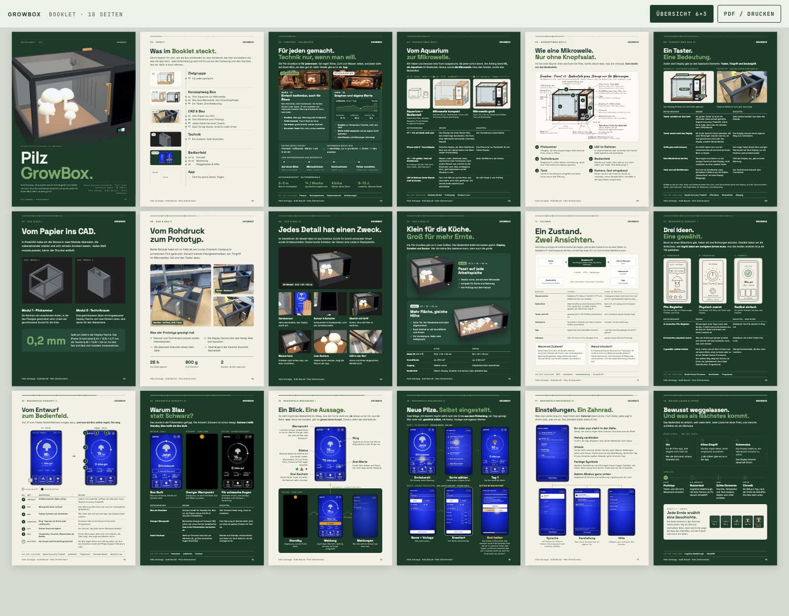
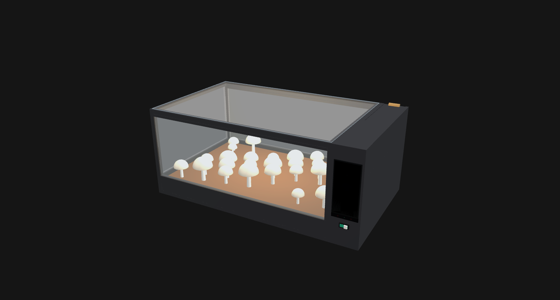

# M-M Interaction

**Booklet, aktueller Stand (18 Seiten, Kapitel App folgt):** `04-final/booklet.html` in Brave öffnen, „Übersicht 6×3“ zeigt alle Seiten.

[](04-final/booklet.html)

Growbox für Pilze mit Fokus auf **Mensch-Maschine-Interaktion** (HCI, Prof. Zagel, Option B). Bedienung **an der Box** über ein eingebautes iPhone und einen Taster, **aus der Ferne** über eine separate App.

**Präsentation ✅ 05.11.2026 · Abgabe 08.11.2026, 23:59** (Booklet 5 Seiten pro Person + Prototyp)

**▶ Bedienfeld live zum Ausprobieren: https://claude.ai/artifact/NHS2mr5kJKUXR1yPjPjrXi** (nur das Display, wie später in der Box; derselbe Link am Mac und am Handy) · **iPhone in der Box im Vollbild:** `sh 01-konzept/bedienfeld/iphone-server.sh`

[](01-konzept/bedienfeld/)

[](04-final/3d-modell/)

3D-Modell zum Drehen: `04-final/3d-modell/growbox-3d-v2-60x35x25.html` im Browser öffnen.

Aktueller Stand v7; ältere Stände im Archiv `01-konzept/bedienfeld/verlauf/`. Das Bild erzeugt `sh 01-konzept/bedienfeld/screenshot.sh`.

## Wo wir stehen (05.11.2026)

```
01 Konzept ✅ ──► 02 Box-Bau 🔄 ──► 03 Software ⏸ ──► 04 Final 🔄
Bedienfeld v7     Skizzen v1–v3      ruht (Pi später)   Präsentation ✅
Personas, Folien  Box bauen, Fotos                      Booklet bis 08.11.
```

| Schritt | Steht | Fehlt |
|---|---|---|
| **01 Konzept** | **Bedienfeld v7** ([Spezifikation](01-konzept/bedienfeld/README.md)), Folien-Recherche, Begriffe Box ↔ App, Personas | – |
| **02 Box-Bau** | Zeichnungen (Front v1–v3, Gestell, Sockel, Bedienfeld, Farben) | Box bauen, Fotos, FreeCAD-Bilder vom Kollegen |
| **03 Software** | erster Entwurf (FastAPI), zeigt noch die alte Oberfläche | ruht bewusst (Interface vor Pi) |
| **04 Final** | Präsentation gehalten, Entscheidungen E1–E31, Bedienfeld v6 + v7 eingefroren, Farbsimulation | **Booklet** schreiben (📘 markiert, was hineingehört); Tests in `04-final/evaluation/` |

## Das Wichtigste

| | |
|---|---|
| **Konzept** | Pilz-Growbox, die das Klima selbst regelt und am Gerät **radikal einfach** bedient wird: ein großer Zustand, drei Kacheln, ein Taster. Die App ist ein Zusatz. |
| **Ziel** | Mit einem Blick sehen, ob etwas zu tun ist; die drei Aufgaben ohne Anleitung erledigen |
| **Zielgruppe** | alle Altersgruppen; Maßstab ist **Ingrid** (wenig Technik, Lesebrille, unsichere Hände); der **Power-User** bekommt die App |
| **Bewertung** | HCI-Prüfung Prof. Zagel, Option B: Booklet 5 Seiten pro Person (50 %) + Prototyp (50 %) |

- **Interaktion vor Technik:** Feuchte und Temperatur simuliert, echt sind Taster und LED
- **Eine Quelle pro Frage:** was gilt → `BRIEF.md` · warum (mit Folie) → `04-final/entscheidungen-folien.md` · wie es aussieht → `01-konzept/bedienfeld/README.md`
- **📘** markiert überall, was ins Booklet gehört


## Priorität: Was macht die Box, was macht der Mensch?

Kernidee des Interaktionskonzepts. Die Box regelt das Klima selbst und **zeigt sichtbar, was sie tut**. Der Mensch hat nur wenige, klar erkennbare Aufgaben, und genau diese Aufgaben müssen am Gerät **leicht erreichbar** sein.

| Die Box regelt selbst (sichtbar unter KLIMA) | Der Mensch macht (die Box meldet sich) |
|---|---|
| Licht 8–20 Uhr (Ausnahme: Taster, App) | **Wasser nachfüllen**, die häufigste Handlung, ca. 1× pro Woche |
| Frischluft: Lüfter alle 30 Min und bei hohem CO₂ | **Ernten** |
| Luftfeuchte: Nebler bei zu trockener Luft | **Neu ansetzen** (Kammer leeren, Zuchtset einsetzen) |
| Wärme: Heizung bei zu kalt | Box **umstellen**, wenn es zu warm ist (Kühlen gibt es nicht) |

Folge für den Bau: Was der Mensch tun muss, muss gut erreichbar sein. **Wassertank und Aufstellort** sind deshalb Teil der Interaktion (siehe Offen).

## Was wir bauen

```text
  Bedienfeld in der Box               separate App
  (iPhone, 01-konzept/bedienfeld/)    ├─ Seite 1: einfache Übersicht
  + Taster                            ├─ 4 weitere Unterseiten
                                      └─ 1 davon: Advanced Analytics
```

**Booklet als Story:** ein einfacher Nutzer und ein Power-User, der alles trackt. Dazu ein Ausschnitt aus dem Bauprozess mit Skizzen und 1–2 FreeCAD-Bildern. Jede Szene bekommt einen HCI-Bezug mit Folie.

## Offen

- [ ] **Aufstellort:** Wo steht die Box (Küche, Regal)? Freier Zugang von vorn und zum Tank, Lüftungsschlitze frei, keine Heizung oder Sonne, Display gut sichtbar.
- [ ] **Pilz als Status:** Pilz-Gesicht (froh/besorgt) und Wachstum in drei Stufen gibt es. Soll „alles gut“ noch deutlicher werden?
- [ ] **Farben 3D-Druck:** Rahmen schwarz oder grau, Variante A oder B ([Skizze](02-box-bau/zeichnungen/skizze-farben.html)). Fest: Handybox schwarz glänzend; Taster und Griffe beige; Orange nur für Warnungen.
- [ ] Wer macht das Backend, und wird der Entwurf in `03-software` genutzt?

## Ordner

```text
M-M-Interaction/
├── README.md        diese Übersicht
├── BRIEF.md         alle Entscheidungen im Detail
├── AGENTS.md        Regeln für den KI-Agenten
├── learnings.md     Learnings für weitere Uni-Projekte
├── 01-konzept/      ✅ Personas, HCI-Konzepte, Bedienfeld (v7)
├── 02-box-bau/      🔄 Zeichnungen der Box
├── 03-software/     ⏸ Software für den Raspberry Pi (ruht)
└── 04-final/        🔄 Präsentation, Booklet, 3D-Modell, Evaluation
```

## Links

- **Bedienfeld live:** https://claude.ai/artifact/NHS2mr5kJKUXR1yPjPjrXi
- **3D-Modell zum Drehen:** [`04-final/3d-modell/`](04-final/3d-modell/)
- **Learnings für weitere Uni-Projekte:** [`learnings.md`](learnings.md)
- Schritte: [01 Konzept](01-konzept/) · [02 Box-Bau](02-box-bau/) · [03 Software](03-software/) · [04 Final](04-final/) · Entscheidungen: [`BRIEF.md`](BRIEF.md)
