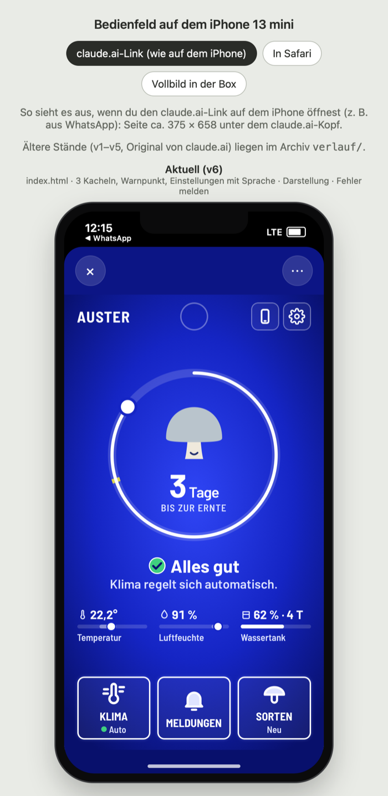

# M-M Interaction

Growbox für Pilze mit Fokus auf **Mensch-Maschine-Interaktion** (HCI, Prof. Zagel, Option B). Bedienung **an der Box** über ein eingebautes iPhone und einen Taster, **aus der Ferne** über eine separate App.

**Präsentation 05.11.2026, 10:00 · Abgabe 08.11.2026, 23:59**

**▶ Bedienfeld live zum Ausprobieren: https://claude.ai/artifact/NHS2mr5kJKUXR1yPjPjrXi** (aktueller Stand, Ansichten claude.ai/Safari/Vollbild) · **nur aktueller Entwurf: https://claude.ai/artifact/Lk5ruX821tCk1WkfVvBxKC** (beide werden bei jeder Änderung neu veröffentlicht, gleiche Links)

[](01-konzept/bedienfeld/)

Aktueller Stand; ältere Stände liegen im Archiv `01-konzept/bedienfeld/verlauf/`. Das Bild erzeugt `sh 01-konzept/bedienfeld/screenshot.sh`.

## Wo wir stehen (02.11.2026)

| Schritt | Status | Was steht | Was fehlt |
|---|---|---|---|
| **01 Konzept** | 🔄 in progress | **Bedienfeld v6** in [`01-konzept/bedienfeld/`](01-konzept/bedienfeld/) (alte Stände im Verlauf), Folien-Recherche, Begriffsliste Box ↔ App, Personas | Entscheidungen A/B am 04.11. (unten), Booklet-Story |
| **02 Box-Bau** | 🔄 in progress | Zeichnungen fertig (Front v2 mit Wassertank, Gestell, Sockel, Bedienfeld, Farbvarianten) | Box bauen, Fotos, FreeCAD-Bilder vom Kollegen einsammeln |
| **03 Software** | ⏳ pending | erster Entwurf vorhanden, nicht abgestimmt | Backend klären; zurzeit keine Priorität |
| **04 Evaluation** | 🔄 in progress | Entscheidungen mit Personen und Folien (E1–E29), **Präsentationsplan 7 min** in [`04-evaluation/`](04-evaluation/) | Cognitive Walkthrough, Nutzertest, AttrakDiff |
| **Booklet** | ⏳ pending | Idee: großteils als Story | Gliederung und Text (5 Seiten pro Person) |

## Priorität: Was macht die Box, was macht der Mensch?

Kernidee des Interaktionskonzepts. Die Box regelt das Klima selbst und **zeigt sichtbar, was sie tut**. Der Mensch hat nur wenige, klar erkennbare Aufgaben, und genau diese Aufgaben müssen am Gerät **leicht erreichbar** sein.

| Die Box regelt selbst (sichtbar unter KLIMA) | Der Mensch macht (die Box meldet sich) |
|---|---|
| Licht 8–20 Uhr (Ausnahme: Taster, App) | **Wasser nachfüllen**, die häufigste Handlung, ca. 1× pro Woche |
| Frischluft: Lüfter alle 30 Min und bei hohem CO₂ | **Ernten** |
| Luftfeuchte: Nebler bei zu trockener Luft | **Neu ansetzen** (Kammer leeren, Zuchtset einsetzen) |
| Wärme: Heizung bei zu kalt | Box **umstellen**, wenn es zu warm ist (Kühlen gibt es nicht) |

Folge für den Bau: Was der Mensch tun muss, muss gut erreichbar sein. **Wassertank und Aufstellort** sind deshalb Teil der Interaktion (siehe Offen).

## Was wir bauen

```text
  Bedienfeld in der Box               separate App
  (iPhone, 01-konzept/bedienfeld/)    ├─ Seite 1: einfache Übersicht
  + Taster                            ├─ 4 weitere Unterseiten
                                      └─ 1 davon: Advanced Analytics
```

**Booklet als Story:** ein einfacher Nutzer und ein Power-User, der alles trackt. Dazu ein Ausschnitt aus dem Bauprozess mit Skizzen und 1–2 FreeCAD-Bildern. Jede Szene bekommt einen HCI-Bezug mit Folie.

## Offen

- [ ] **Aufstellort:** Wo steht die Box (Küche, Regal)? Freier Zugang von vorn und zum Tank, Lüftungsschlitze frei, keine Heizung oder Sonne, Display gut sichtbar.
- [ ] **Mittwoch 04.11. entscheiden:** **A** Warnung zusätzlich als physisches Licht an der Box (falls das Display aus ist oder ausfällt) oder nur Display + App? **B** Taster schaltet Licht **und** Display gemeinsam an/aus, Warnung bleibt unabhängig sichtbar? Details: [`04-evaluation/entscheidungen-folien.md`](04-evaluation/entscheidungen-folien.md#offen-für-mittwoch-0411)
- [ ] **Pilz als Status:** Das Pilz-Gesicht im Ring zeigt den Zustand schon (froh/besorgt/gestresst). Wie wird deutlicher, dass „alles easy läuft“?
- [ ] **Farben 3D-Druck:** Variante A, B oder C ([Skizze](02-box-bau/README.md#5--farbvarianten-3d-druck)). Fest: Handybox schwarz glänzend; Bedienteile farblich vom Rest abheben.
- [ ] Wer macht das Backend, und wird der Entwurf in `03-software` genutzt?

## Ordner

```text
M-M-Interaction/
├── README.md        diese Übersicht
├── BRIEF.md         alle Entscheidungen im Detail
├── AGENTS.md        Regeln für den KI-Agenten
├── 01-konzept/      🔄 Personas, Storyboards, HCI-Konzepte, Bedienfeld
├── 02-box-bau/      🔄 Zeichnungen der Box
├── 03-software/     ⏳ Software für den Raspberry Pi
└── 04-evaluation/   ⏳ Tests und Ergebnisse
```
