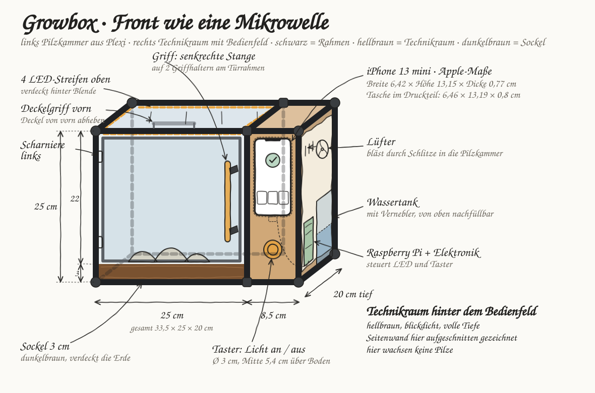
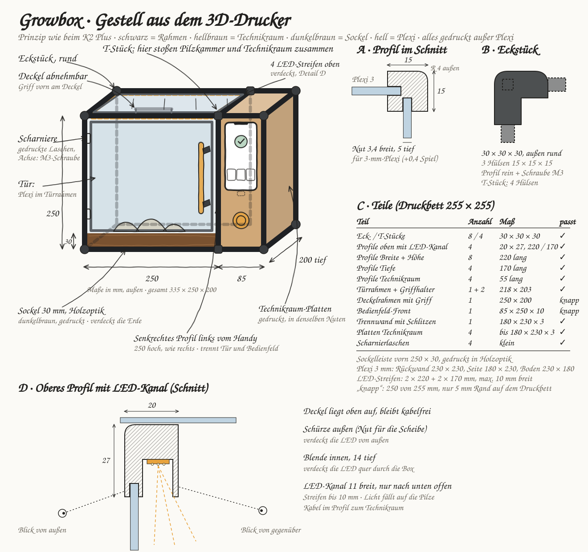
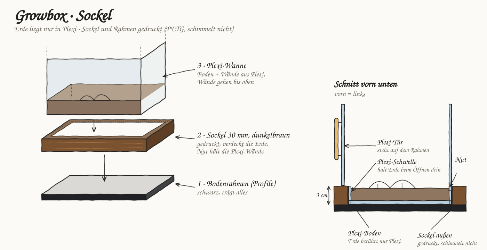
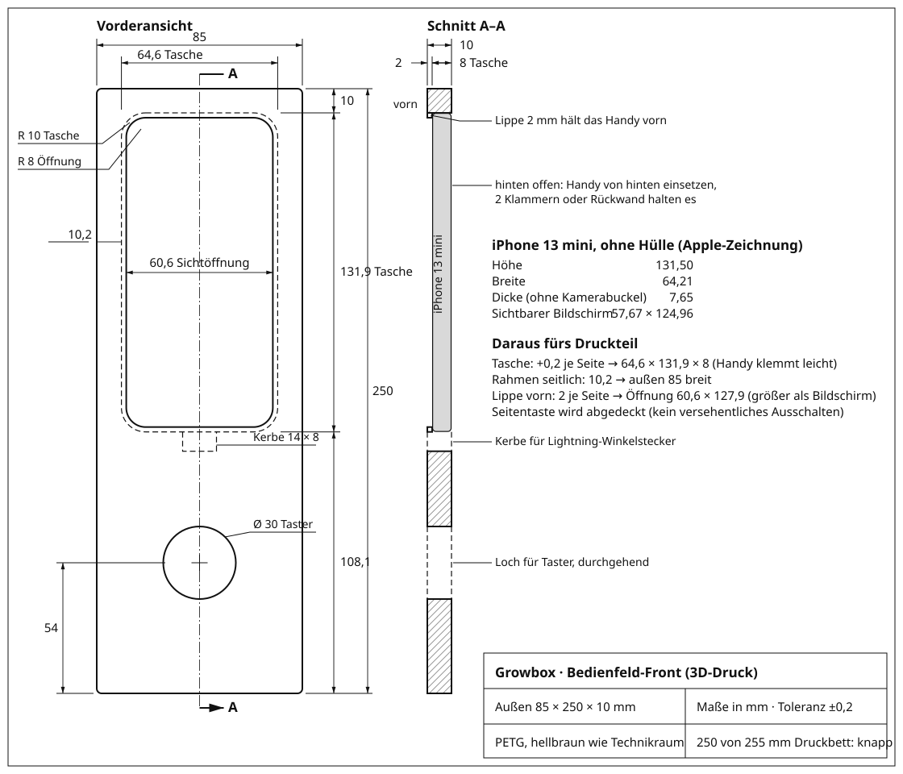
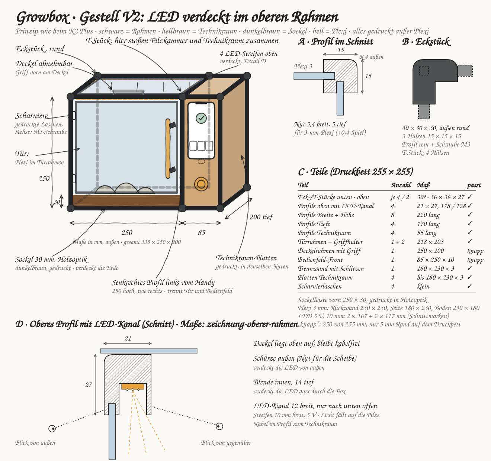
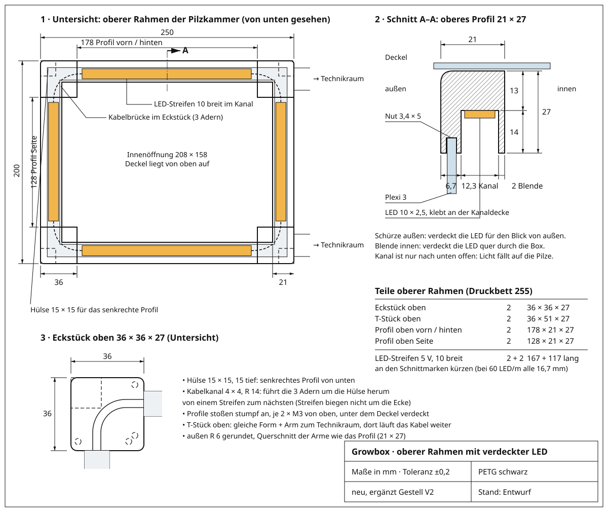

# Konzept-Material

Aktueller Stand der Box als Bilder (direkt auf GitHub sichtbar). Lokal gibt es dieselben Zeichnungen interaktiv in [`index.html`](index.html).

## 1 · Front-Skizze: Aufbau wie eine Mikrowelle

## 2 · Gestell aus dem 3D-Drucker (Prinzip K2 Plus)

## 3 · Sockel

## 4 · Technische Zeichnung Bedienfeld-Front

## Neu: LED verdeckt im oberen Rahmen

Ergänzt die Zeichnungen oben, ersetzt sie nicht. Die älteren Stände bleiben als Dokumentation unverändert.

### 5 · Gestell V2: dickere obere Verbindungsstücke

### 6 · Technische Zeichnung oberer Rahmen mit LED-Kanal

## Dateien

| Datei | Inhalt |
|---|---|
| [`skizze-box.html`](skizze-box.html) | Front-Skizze: Pilzkammer, Technikraum, Maße 335 × 250 × 200 |
| [`skizze-gestell.html`](skizze-gestell.html) | Gestell: Profile, Eckstück, LED-Profil, Teileliste |
| [`skizze-sockel.html`](skizze-sockel.html) | Sockel 30 mm, Bodenrahmen, Plexi-Wanne |
| [`zeichnung-bedienfeld.html`](zeichnung-bedienfeld.html) | Bedienfeld-Front 85 × 250 × 10 mit iPhone-Tasche |
| [`skizze-gestell-v2.html`](skizze-gestell-v2.html) | Gestell V2: obere Profile 21 × 27 mit verdeckter LED |
| [`zeichnung-oberer-rahmen.html`](zeichnung-oberer-rahmen.html) | Oberer Rahmen: Untersicht, Profil-Schnitt, Eckstück oben, Teile |
| [`masse-iphone-13-mini.md`](masse-iphone-13-mini.md) | iPhone-Maße aus Apples Zeichnung |
| [`export_svg.py`](export_svg.py) | erzeugt `bilder/*.svg` aus den HTML-Seiten |

**Neue Stände als neue Datei anlegen** (z. B. `-v2`), bestehende Zeichnungen bleiben als Dokumentation. Danach `python3 konzept/export_svg.py` ausführen und die Bilder mit committen. Schriften (OFL-Lizenz) liegen in `fonts/`.

## Oberfläche und Nutzer

- **Konzept-Skizzen der Oberfläche (Blätter 01–14 mit Vorlesungsbezug):** https://claude.ai/artifact/7MF2tG589SHFE4ghP35TE9 – privat
- **Personas und Storyboards:** [`personas-storyboard.md`](personas-storyboard.md)
- **Vorlesungskonzepte mit Foliennummern:** [`../HCI-KONZEPTE.md`](../HCI-KONZEPTE.md)
- **Entscheidungen:** [`../BRIEF.md`](../BRIEF.md)

Hier ablegen: Fotos vom Papierprototyp, Testprotokolle, AttrakDiff-Ergebnisse.
